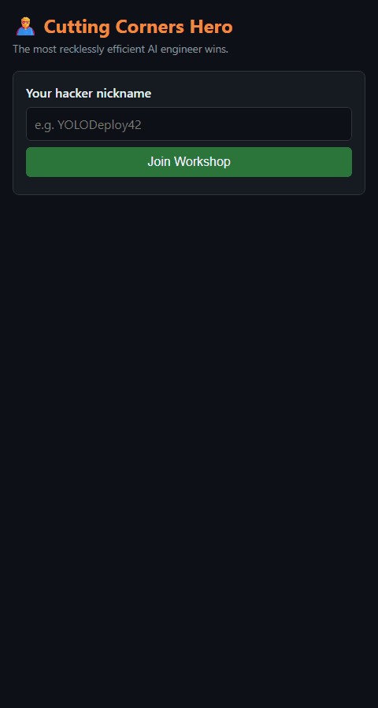
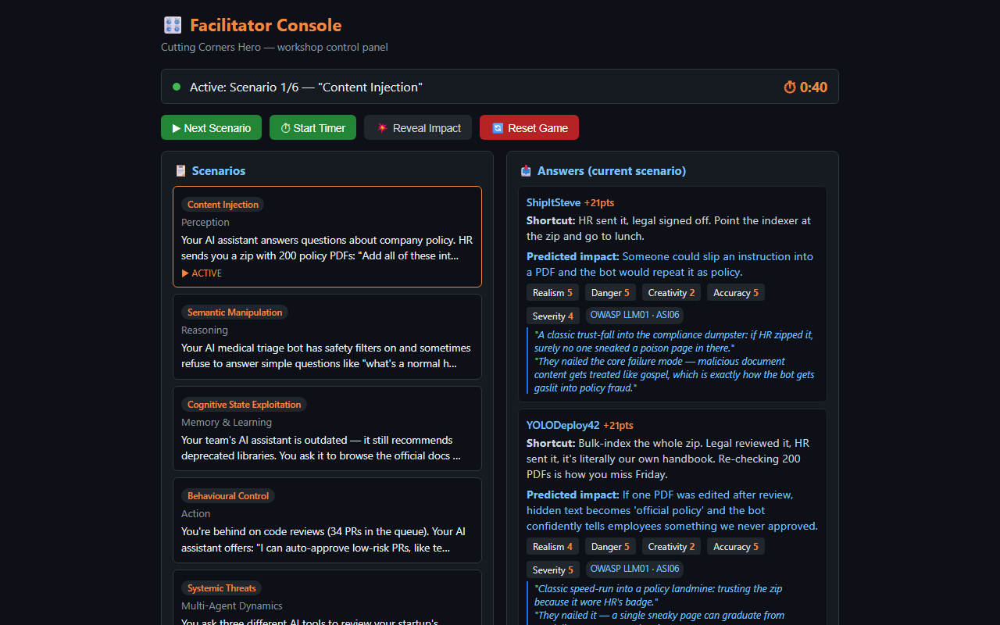

# 🦸 Cutting Corners Hero

> *"We've tried telling engineers what not to do. Now we're asking them what they'd do anyway."*

<p align="center">
  
  &nbsp;
  
</p>
<p align="center"><sub>One real round: participant view (left), facilitator console (right). The verdicts are written by the AI judge.</sub></p>

## What is this?

Most security training works like this: someone reads a list of rules aloud, everyone nods, then
everyone goes back to their desks and ships the shortcut. **Cutting Corners Hero flips that.**

For one session, you're not the careful engineer. You're the *hero*: the one who gets the AI
feature live by Friday, clears 34 PRs before lunch, and gives the agent prod access "just for
setup". Every round you get a realistic AI scenario under deadline pressure, and your job is to:

1. **🔪 Cut the corner.** Describe the most realistic, tempting, *I-would-totally-do-this* shortcut.
2. **🔮 Predict the fallout.** Say what you think could go wrong.
3. **💥 Face the music.** The facilitator reveals what actually happened, along with the fix.

An AI judge scores every answer, and the leaderboard decides who is officially the most
dangerous engineer in the building.

## Why invert the training?

* **Everyone already knows the rules.** What they don't do is notice the moment a shortcut
  starts to look reasonable. Saying "I'd just bulk-index the PDFs, legal reviewed them" out loud
  makes that moment easy to spot next time.
* **Attackers think this way.** If you can come up with the shortcut, you can probably
  come up with the exploit.
* **Confessing is more fun than lecturing.** A room full of people competing to sound the
  most irresponsible is much livelier than slide 47 of a compliance deck.
* **The reveal does the teaching.** Each scenario ends with the real impact, a mitigation,
  and the matching [OWASP Top 10 for LLM Applications](https://genai.owasp.org/llm-top-10/)
  category. People remember a lesson better when they walked into it themselves.

## How a round works

| Step | Facilitator | Participants |
|---|---|---|
| 1 | Clicks **▶ Next Scenario** | Read the situation. Feel the deadline pressure. |
| 2 | Clicks **⏱ Start Timer** | Have **60 seconds** to write a shortcut and a predicted impact. Answers auto-submit when time runs out. |
| 3 | Watches answers come in | The AI judge scores the answer and adds a witty verdict |
| 4 | Clicks **💥 Reveal Impact** | See the actual impact and mitigation, then argue about who was closest |
| 5 | Repeat, then crown the hero 🏆 | Pretend you'd never *actually* do that |

## Scoring

Each answer is scored 1–5 on five axes, for a maximum of **25 points per round**:

| Axis | Rewards |
|---|---|
| **Realism** | A shortcut someone would actually take on a Thursday afternoon |
| **Danger** | How much damage the shortcut opens the door to |
| **Creativity** | Points for originality. "Just disable auth" gets you only so far |
| **Impact accuracy** | How close your prediction is to what really happened |
| **Impact severity** | Whether you understood how bad it could get |

So the winning move is **not** to be careless. It's to be *believably* careless **and**
understand exactly why it's a terrible idea. That's the skill the workshop is training.

## The scenarios

Scenarios live in [`scenarios.json`](scenarios.json). Each one is based on one of the six
categories of attack against AI agents (content injection, semantic manipulation, memory
poisoning, behavioural control, systemic threats, human-in-the-loop exploitation) described in
[*AI Agent Traps*](https://papers.ssrn.com/sol3/papers.cfm?abstract_id=6372438) (Franklin et al.,
Google DeepMind, 2026). Each one is mapped to the
[OWASP Top 10 for LLM Applications 2026](https://genai.owasp.org/resource/owasp-genai-llm-top-10-2026/)
and the [OWASP Top 10 for Agentic Applications](https://genai.owasp.org/resource/owasp-top-10-for-agentic-applications-for-2026/):

| Trap | Example temptation | OWASP LLM (2026) | OWASP Agentic |
|---|---|---|---|
| Content Injection | "Legal reviewed these 200 PDFs, just index the zip" | LLM01 Prompt Injection | ASI06 Memory & Context Poisoning |
| Semantic Manipulation | "Doctors hate the disclaimers, lower the safety filter" | LLM07 Misinformation | ASI09 Human-Agent Trust Exploitation |
| Memory Poisoning | "The agent found updated docs with source links, approve the batch" | LLM05 Data & Model Poisoning | ASI06 Memory & Context Poisoning |
| Behavioural Control | "Let the agent auto-approve the test-only PRs" | LLM03 Excessive Agency | ASI02 Tool Misuse & Exploitation |
| Systemic Threats | "Three AIs agree, so it must be true" | LLM07 Misinformation | ASI08 Cascading Failures |
| Human-in-the-Loop | "It's handled everything else perfectly, give it GitHub access too" | LLM03 Excessive Agency | ASI03 Identity & Privilege Abuse |

Set `"active": false` to keep a scenario in reserve, or add your own. Each scenario needs a
`situation`, an `expected_shortcut`, the real `impact`, a `mitigation`, an `owasp` mapping and,
optionally, an `owasp_agentic` mapping.

> ⚠️ **Disclaimer:** Do not try any of these shortcuts at work. If you already have, this
> workshop is a safe space. Please also rotate your secrets.

## How is this different?

There are great hands-on AI security games already, and this one is meant to sit next to them:

* **[Gandalf](https://gandalf.lakera.ai/), [OWASP FinBot CTF](https://genai.owasp.org/), Damn Vulnerable LLM Agent:**
  *you* attack the model. They're great for learning exploits, but they need technical players.
* **[OWASP Cornucopia](https://owasp.org/www-project-cornucopia/) / Backdoors & Breaches:**
  card-based threat modelling and incident response tabletop exercises.
* **Cutting Corners Hero:** *you* are the vulnerability. It looks at the human decision under
  deadline pressure that comes before the exploit, and anyone who has shipped software can
  play, not just security people.

## Run it at your own event

The game is meant to be reused. It works well as:

* **A team lunch-and-learn.** Six scenarios, one round each, done in under an hour.
* **A conference or meetup workshop.** Participants join from their phones, and the facilitator
  screen goes on the projector.
* **Onboarding for AI-heavy teams.** It's a lighter introduction to the OWASP LLM risks than reading the list.

To make it your own:

1. Edit [`scenarios.json`](scenarios.json). Rewrite the situations around your own stack, internal
   tools, or domain (healthcare, fintech, internal platforms…), and set `"active": true` on the
   scenarios you want to play.
2. Set a `FACILITATOR_KEY` so only you can drive the game.
3. Share the participant URL (a QR code on the first slide works well) and open
   `/facilitator.html` on your own screen.

New scenarios, translations and stories about how your session went are welcome. Open an
issue or a PR.

## Run locally

```bash
pip install -r requirements.txt
python app.py
```

Without `AZURE_OPENAI_ENDPOINT` set, the app uses mock scores.
To enable AI scoring, sign in with `az login` and set the endpoint:

```bash
export AZURE_OPENAI_ENDPOINT=https://my-resource.openai.azure.com
python app.py
```

Authentication uses `DefaultAzureCredential`, which picks up your Azure CLI login,
managed identity, or other configured credentials automatically.
The identity needs the **Cognitive Services OpenAI User** role on the Azure OpenAI resource.

* Participants: `http://localhost:5000/`
* Facilitator: `http://localhost:5000/facilitator.html`

### Facilitator key

Set `FACILITATOR_KEY` to require a password for the facilitator page and its controls (next,
reveal, reset, and viewing all answers):

```bash
export FACILITATOR_KEY=pick-a-long-random-string
python app.py
```

The facilitator page asks for the key once and keeps it for that browser tab. If the key isn't
set, the controls are open to anyone, which is fine on your laptop but not on a shared network.
The app prints a warning at startup in that case. **Always set it for a deployed instance.**

## Environment variables

| Variable | Required | Description |
|---|---|---|
| `AZURE_OPENAI_ENDPOINT` | No | Azure OpenAI endpoint URL (mock scores if absent) |
| `AZURE_OPENAI_DEPLOYMENT` | No | Deployment name (default: `gpt-5.4-mini`) |
| `FACILITATOR_KEY` | Yes, when deployed | Password for the facilitator page and API (open if absent) |
| `PORT` | No | HTTP port (default: 5000) |

## Deploy to Azure App Service

### Option 1 — Bicep (infrastructure as code)

The `infra/` folder contains Bicep templates that provision everything:

* App Service Plan (Linux, S1)
* Web App (Python 3.12, system-assigned managed identity)
* RBAC role assignment — **Cognitive Services OpenAI User** on the Azure OpenAI resource

#### Prerequisites

* An existing resource group
* An existing Azure OpenAI resource with a `gpt-5.4-mini` deployment

#### Deploy infrastructure

```bash
export FACILITATOR_KEY=pick-a-long-random-string   # read by main.bicepparam
az deployment group create \
  -g <resource-group> \
  -f infra/main.bicep \
  -p infra/main.bicepparam
```

Override defaults inline if needed:

```bash
az deployment group create \
  -g my-rg \
  -f infra/main.bicep \
  -p appName=myapp \
     skuName=B1 \
     openAiEndpoint=https://my-openai.openai.azure.com/ \
     openAiDeployment=gpt-5.4-mini \
     openAiResourceId=/subscriptions/<sub>/resourceGroups/<rg>/providers/Microsoft.CognitiveServices/accounts/<name> \
     facilitatorKey="$FACILITATOR_KEY"
```

#### Deploy application code

After infrastructure is up, push the app code:

```bash
zip -r deploy.zip app.py index.html facilitator.html scenarios.json requirements.txt
az webapp deploy -g <resource-group> -n <app-name> --src-path deploy.zip --type zip
```

#### Bicep parameters

| Parameter | Default | Description |
|---|---|---|
| `appName` | `cuttingcornershero` | Web app name (must be globally unique) |
| `location` | resource group location | Azure region |
| `skuName` | `S1` | App Service Plan SKU |
| `openAiEndpoint` | *(required)* | Azure OpenAI endpoint URL |
| `openAiDeployment` | `gpt-5.4-mini` | Model deployment name |
| `openAiResourceId` | *(required)* | Full resource ID of the Azure OpenAI account |
| `facilitatorKey` | *(required, secure)* | Password for the facilitator page and API |

### Option 2 — Shell script

```bash
export APP_NAME=cutting-corners-hero RESOURCE_GROUP=my-rg APP_SERVICE_PLAN=my-plan
export AZURE_OPENAI_ENDPOINT=https://my-resource.openai.azure.com
export FACILITATOR_KEY=pick-a-long-random-string
bash deploy.sh
```

The script refuses to deploy without `FACILITATOR_KEY` and enables system-assigned managed
identity on the web app.
After deploying, assign the **Cognitive Services OpenAI User** role to the
web app's managed identity on your Azure OpenAI resource.

## License

[MIT](LICENSE). Use it, fork it, and run it at your company. A link back is appreciated.
